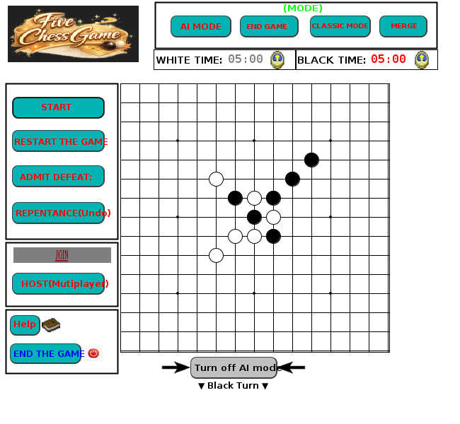

# Connect5 (Gomoku in Java)

Five-in-a-row on a 15x15 board, made by three of us for the Software Development 2 module at Griffith College Dublin (March to May 2026). You can play against a friend on the same computer, against the computer, or against someone else over the network.



## What it can do

- Classic mode, plus a merge mode where you can also play on top of one of your own pieces to merge them. The win check handles merged pieces.
- Two computer opponents. Easy just picks a random free spot. Medium goes through all 225 cells, gives each one a score for how much it helps its own lines and how much it blocks yours, and plays the highest one.
- Online play. One player hosts on a port, the other joins with the host's IP and the same port. Moves go over a TCP socket as text messages like `MOVE,7,8,1`, and a listener thread applies the other player's moves so both boards stay the same. On the `Algorithm-and-logic` branch I also added `UNDO` and `RESTART` messages and a small network log.
- Undo (move history kept in a stack).
- A 5 minute clock for each player. If yours runs out you lose.
- Endgame puzzles loaded from a text file: 15 lines of 15 numbers, 0 is empty, 1 is black, 2 is white. There is an example in `src/level1.txt`.
- JUnit tests for placing pieces, wins in all four directions, undo, full board, merge mode and the AI.

## How to run

You need JDK 17 or newer.

```
git clone https://github.com/GeJingzu/connect5-gomoku.git
cd connect5-gomoku
javac -d out $(find src/Gobang -name "*.java" ! -name "*?Test.java")
cp -r src/images out/
java -cp out Gobang.Test
```

(`Test.java` is the class that starts the game. The files ending in `Test.java` are the unit tests and need JUnit 4, so they are left out of the command above.)

The easiest way is to open the folder in IntelliJ, add JUnit 4 to the module, and run `Gobang.Test` for the game or any `*Test` class for the tests.

For online play, one player clicks **HOST** and types a port (e.g. 5000), the other clicks **JOIN** and types the host's IP and the same port. Both computers need to be on the same network.

## Files

| File | What's in it |
|---|---|
| `Gomokulogic.java` | board, placing pieces, turns, win/draw checks, undo, easy and medium AI |
| `NetworkManager.java` | host/join, listener thread, messages |
| `BoardPanel.java`, `ChessFrame.java` | the Swing window, buttons, timer |
| `MergeSystem.java` | switching between classic and merge mode |
| `EndgameLoader.java` | reading endgame boards from .txt files |
| `*Test.java` | tests |

## Team

The commit history is the same as on our college GitLab.

- Jingzu Ge (me): the game logic in `Gomokulogic` (board, win checks, draw check, turns, undo), the easy and medium AI, the networking in `NetworkManager`, and the tests for my parts. Most of my commits are on the `Algorithm-and-logic` branch.
- Yunlong Wang: the Swing UI, the timer, the AI difficulty menu, and putting everyone's code together into the final game (`main`).
- Yutian Wang: merge mode and the endgame loader/manager, with tests.

## Things I learned

Keeping two boards in sync over a socket was the tricky part. Anything that changes the board has to go through the same code path, otherwise the two players end up looking at different games. Writing the win-check tests early also caught a few off-by-one bugs at the edges of the board.
